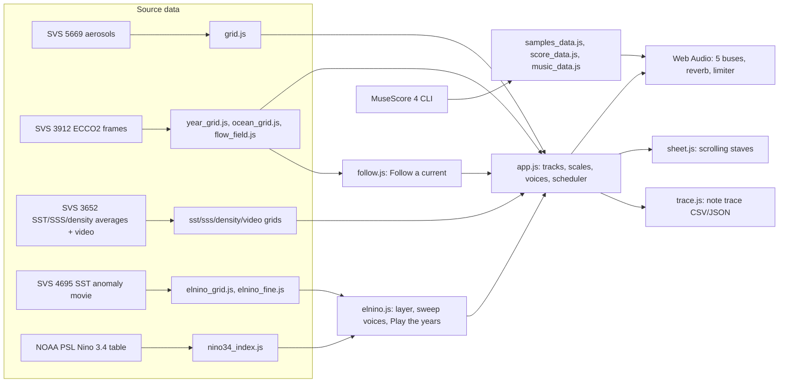

# Earth Jukebox: knowledge graph (quick context)

Last updated: 14 Nov 2026. Read this first, then `README.md` (what it does and its limits) and `PROCESS.md` (why each choice, mistakes, what was checked).
Format: entities are `##` headings; relationships are written as `A —verb→ B`; **bold** = a decision or fact that is easy to get wrong.

## 0. One-paragraph summary
A browser app (plain HTML and JS, no build, works opened from a folder) that turns NASA ocean and atmosphere pictures into live music while the picture stays on screen. Built for the **NASA Space Apps Challenge 2026, "The Earth Information Jukebox"**. **Deadline: 15 Nov 2026, 23:59 local.** It is an independent project, not a NASA product. Developed with Claude Code; the AI disclosure is in `README.md`. Repo: <https://github.com/AstroPi-9/space-apps-challenge-earth-jukebox> (**private**; make public only after the checks in section 12).

## 1. Relationship map

## 2. Where things are
- Workspace: `C:\Users\astro\Documents\Space Apps Challenge\` (the git root). **App folder: `Earth Jukebox\`.** Other folders: `Aerosols\` (raw SVS 5669 images), `salinity and density\` (raw SVS 3652, 869 MB, **git-ignored**), `El Nino data\` (raw downloads, **git-ignored**), `Challenge details.txt`, `ecco2_and_grid.jpg`, `.claude\launch.json`.
- Related prior project: `C:\Users\astro\Documents\RAM-AVATAR-Earth-Jukebox` (Python/Tkinter, picture-colour statistics). **Methods reimplemented, no code copied**; its rights and licences are unconfirmed (see section 12). Its Python venv is used to run our numpy-only analysis scripts.
- USB drive `E:` : `Time- light\data\Oceanflows` holds the 2,001 ECCO2 frames (SVS 3912) used for the Year track.
- Dev server: preview config "earth-jukebox" runs `tools\serve.ps1` on **port 8765** (supports range requests; dev-only POST `/save/<name>.js` used by the analysis tools). Needed only for the video and pixel analysis tools; the app itself runs from `file://`. Open `http://localhost:8765/index.html?debug` for the test hook `window.__jb`; `?nostart` skips the welcome dialog.

## 3. Code modules (all classic scripts; `app.js` is one IIFE)
| File | Role |
|---|---|
| `index.html` | All markup and CSS (wooden jukebox theme on every page; old flick switches for every checkbox, drawn with SVG background images; the general settings live in the `#jbSettings` panel opened by the top-right `#jbSetBtn` tab on the home and second pages, and the data page keeps only record-specific settings). Script order matters: data files, `source_hashes.js`, `trace.js`, `sheet.js`, `app.js`, `follow.js`, `elnino.js`. |
| `app.js` | Tracks and their data decoding text, scales and emotion, harmony, voices (synth), drums, scheduler, narration, demo, start dialog, sources. **Private scope: other files reach it only through `window.EJ`** (getters for `A`, `T`, `playing`; `traceContext()`, `follow.*` API, etc.). |
| `sheet.js` | Scrolling sheet music. `noteLog(v,t,m,d,stroke,id)` is called by every voice; also forwards to the trace. |
| `follow.js` | Follow a current: traces a path along flow lines (`flow_field.js`) and sonifies temperature. |
| `elnino.js` | El Niño layer: overlay from `elnino_fine.js`, anomaly voices in the sweep, "Play the years". |
| `jukebox.js` | The jukebox home page, second pages (`GROUPS`: the versions of sst, sss and density) and doors: `#jukebox` overlay (wood, red buttons) covers the app; choosing a record clicks the hidden track tab, then two cloned halves of the home page swing open; `EJ_songEnded()` (called at the end of a sweep, followed current or years) closes the doors after 3.5 s if the switch is on. `?nohome`, `?debug` and `?nostart` skip the home page. The welcome dialog no longer opens by itself. The app is `inert` while the home page is showing. |
| `hearme.js` | **Hear Me**: off until the `#hearMe` button (home page) is pressed; then speaks a summary of the current screen with the browser's speech voice (home, second page, settings, or data page from `window.EJ.T` and the DOM), re-reads on the `ej-page` event (fired by `jukebox.js` when pages change) and on the H key; `#hearBar` (bottom left) repeats or turns it off. Not persisted. |
| `trace.js` | Records every scheduled note, exports CSV/JSON with source SHA-256s. |
| `*_grid.js`, `elnino_*.js`, `nino34_index.js`, `flow_field.js` | Precomputed data (`window.*_GRID` etc.), 160 columns by 18 latitude rows for sweeps. |
| `music_data.js` / `score_data.js`, `score_notes.js` / `samples_data.js` | MuseScore-rendered audio (base64 mp3): fixed loops / 5 stems and their notes / 18 instruments. |
| `source_hashes.js` | SHA-256 of every asset and data file (rebuilt by `tools\hash-sources.ps1`). |
| `analysis/*.json` | Results of `tools\validate-elnino.py` and `tools\seasonal-cycle.py`. |
| `music_scores/*.mscz` | Editable MuseScore scores (one per track, plus `EarthJukebox_5voice.mscz`). |

## 4. Tracks (tabs, in order)
Ten track ids, six home-page records. `year` (A1; SVS 3912, 160 of 2,001 frames, time sweep) · `ocean` (A2; one frame, **hosts Follow a current**) · `aerosols` (B1) · **B2 Sea temperature:** `sst` (clean still map, SVS 3652), `sstVideo` (turning globe), `sstEl` (the same map with the **El Niño layer**; `elnino.js` shows its panel only when the id is `sstEl`) · **C1 Salinity:** `sss`, `sssVideo` · **C2 Density:** `density`, `densityVideo`. The three video tracks follow one pattern (`globeVideoTrack` in `app.js`; grids `video_grid.js`, `sst_video_grid.js`, `sss_video_grid.js` made by `tools/analyse-video.html?kind=density|sst|sss`; movies in `assets/video/`) and assume the globe starts at 90° W and turns 6°/s. Id-keyed tables (PALETTE, PALETTE_TEXT, TRIMS, TRIMS_S, DATA_INFO, INTRO_HEAD) must get entries for any new track id. The "still" sea temperature is the provided SVS 3652 average map: **no image of a specific year (such as 2026) was provided**.
Sweeps run west to east (time on the Year track), play once and stop. Latitude is pitch in sweeps. Click or arrow keys explore a spot.

## 5. Sound design (what each part is)
- **Five voices, one bus each:** 0 drone, 1 chords (pad), 2 high voice (struck/plucked or rolled), 3 lead (melody), 4 drums. Each track has its own instruments (`PALETTE`). Master chain: voices → `live` gain → mix → reverb → compressor → limiter → gate → master.
- **Scales (`SCALES`):** tonic always D; the scale follows the drum region (tabla = Mayamalavagowla, kit = Ionian, etc.) with a hopeful and a sad form; Mohanam/Hindolam for open ocean and the Year track. Region→drum is `REGIONS`/`regionAt`.
- **Mood:** from the within-track data-strength rank (smoothed): calm, sad (≥0.6, hysteresis 0.5), urgent (strong or sharp rise: heartbeat on each beat plus a tense figure). **The El Niño layer overrides this with the real anomaly** (sad > +0.3 °C mean or ≥ +1.5, urgent ≥ +2.5).
- **Harmonious mode (default on):** one consonant triad per bar, melody and sparkles snapped to chord tones, scale/mood changes held to bar lines, fewer notes. Controlled by `harmOn()`, `curBar`, `chordSnap`.
- **Gamakas toggle:** off = steady notes (no curve). There is **no vibrato** anywhere.
- **Drums:** regional synthesised strokes, speed in four steps (crotchet, quaver, semiquaver, rare demisemiquaver; capped at quavers in harmonious mode), fixed 120 bpm grid.
- **Sound sources (menu):** `live` (default) · `samples` (MuseScore instrument recordings playing the same data-driven notes; drums stay synthesised) · `score` (fixed 5 MuseScore stems modulated by data, Mohanam only). "Composed music underneath" (fixed Mohanam loops, **off by default, clashes with other scales**).
- **Level balance:** measured offline with A-weighting (`renderOffline`, `?debug`): `TRIMS` (live) and `TRIMS_S` (samples) per track; targets lead −22, drums −27, chords −29, high −31, drone −34 dB(A); mix about −21 to −23 dB(A), peaks about −4 dBFS. Drone and lowest bassoon notes are faint on small speakers.
- **Stop means silence:** `hardStop()` mutes and closes the audio context (no fade, no tail). Pause, Follow stop and Hear-instruments stop use it. A new context is created each play.

## 6. Features beyond the sweep
- **Follow a current** (Ocean currents tab): five named currents or a clicked start; the path follows `flow_field.js`; pitch = temperature; warm turns sad (>22.4 °C) and urgent (>28 °C). **Direction is not in the picture**: named currents use their known direction, clicks head east unless Reverse.
- **El Niño layer** (Sea temperature tab): anomaly overlay (3° grid, smooth, transparent near zero, grey boxes where NASA's inset covered the movie), anomaly voices in the sweep (glass = warm, kalimba = cool; pitch = anomaly), month slider/presets, **Play the years** (Niño 3.4 index, one note per 3 months, "rapid onset" urgency from a MAD-scaled rate of change).
- **Sheet music:** one staff per voice, D major key signature with accidentals, words-only line for non-visual use (`#sheetNow`), works in sweep, Follow and years modes.
- **Note trace:** CSV and JSON export of the last run; JSON lists source file SHA-256s, decoding method, checks, limits.
- **Accessibility:** spoken narration (off by default; short/full intro; **speech default off**), Hear the instruments, keyboard exploration, text readouts, per-voice mute, Data and limits panel per track, skip-link.

## 7. Data sources and how values are read (all "decoded from rendered pictures", not raw model data)
| Data | Source | Decoding |
|---|---|---|
| Aerosols, 19 Aug 2025 | NASA SVS 5669 | hue/saturation/brightness classes (smoke, dust, sea salt, sulfate) |
| Year of the ocean, 25 Mar 2007 to 3 Mar 2008 | NASA SVS 3912 (ECCO2), frames from the USB; dates from `flat_ecco2_dates.txt` | colour = sea surface temperature 0–32 °C (hue match ≤4/255, S ≥64/255, V ≥20/255); structure tensor gives swirl and flow direction |
| SST, salinity, density averages | NASA SVS 3652 (released 9 Oct 2009; **averaging period unverified**) | nearest colour on NASA's colour bar; thirds of the colour scale plus fronts |
| SST anomaly maps 1982–2017 | NASA SVS 4695 movie (`assets/elnino/nino34.webm`) | 18 colour bins of 0.5 °C; time axis fitted (0.17685 s per month); **geometry fitted, not documented** |
| Niño 3.4 index | NOAA PSL `nina34.anom.data` (to Oct 2026; **+2.30 °C in Oct 2026**, El Niño range) | used as published; pages disagree on the ERSST version and base period |

## 8. Validation results (see `README.md`, `analysis/`)
- EOF mode 1 of the decoded anomaly maps follows the index at **r = +0.91** (peak near 5° S, 120° W); the decoded Niño box r = 0.96. The picture's anomalies run a few tenths of a degree larger than NOAA's index (baseline difference, **unchecked**).
- Index spectrum: strongest El Niño-band peak **3.6 years**, 61% of variance in 2–8 years.
- Year track seasonal cycle: north warmest late Aug to early Sep, south late Feb to early Mar, mid-latitude amplitude about 4.5–4.8 °C, hemispheres correlate −0.95 (one partial year, 342 days).
- Naive baselines for next-month index: persistence 0.18 °C, climatology 0.65 °C. **The app makes no predictions.**
- Harmonious mode (by counting notes, not listening): melody clashing with chord/drone 73% → 0–11%; lead notes −75%, drums −55%.

## 9. Build and rebuild tools (`tools\`)
PowerShell (Windows): `make-grid.ps1` (aerosols), `make-scalar-grids.ps1` (sst/sss/density), `make-ocean-grid.ps1`, `make-year-grid.ps1`, `make-flow-field.ps1`, `make-music.ps1` (fixed loops + scores), `make-score.ps1` (5-instrument score, stems, notes), `make-samples.ps1` (18 instruments), `hash-sources.ps1`. Browser tools (need `serve.ps1`): `analyse-video.html`, `analyse-nino.html` (writes `elnino_grid.js` and `elnino_fine.js`), `peek-nino.html`. Python (numpy only): `validate-elnino.py`, `seasonal-cycle.py`. **MuseScore 4 CLI:** `C:\Program Files\MuseScore 4\bin\MuseScore4.exe -o out.mp3 in.mid` (MS Basic sound font).
Re-running `make-score.ps1` overwrites `music_scores\EarthJukebox_5voice.mscz`; check for user edits first (use `-StemDir` after editing).

## 10. Decisions and the reasons (do not undo without asking)
- **Add options, do not replace.** The user asked for several features "as an option" (MuseScore source, gamakas toggle, harmonious mode). Defaults: live synthesis; harmonious on; gamakas on; regional scales and emotion on; narration off.
- **Honesty about limits is part of the product.** Every claim about warming, El Niño or ocean physics is qualified; mood from rank was admitted to be relative, then replaced for El Niño by real anomalies. Keep README/PROCESS/Data panels updated with every feature (user expects it).
- **Pitch = latitude in sweeps, pitch = the value (temperature or anomaly) in Follow and El Niño modes** (value is the better use of pitch; latitude is only position).
- **Hear-first, then talk:** narration describes, explains, then the sweep plays once with no talking over it.
- **Autoplay:** browsers need a real click before audio starts; a hidden browser pane auto-pauses playback.
- Persisted preferences in `localStorage`: `ej_seen`, `ej_skipant`, `ej_sheet`.

## 11. Working notes and gotchas for editing
- `app.js` is an IIFE: new code that needs its internals must be exposed on `window.EJ` or added to `__jb` (debug).
- **Do not edit with `perl -e` using quotes or `$(`; it has corrupted files repeatedly.** Use the Edit tool or a Python script with exact-string replace and an assert. **Never put an apostrophe inside a single-quoted JS string** (it broke `app.js` and the analysis page twice). Non-ASCII characters are safe with the Edit/Write tools, not with shell one-liners.
- Long browser tests exceed the 45 s tool limit: start an async job, store results on `window`, poll.
- Git: commit author is `AstroPi-9` with the user's gmail address (will show publicly if the repo goes public); commits end with the Claude co-author line; push to `main`.
- Check scripts parse after edits: fetch each `<script src>` and `new Function(text)` (the console log also keeps stale errors across reloads).

## 12. Open items and unverified claims (be explicit about these)
1. **Nobody has listened to the finished mix.** All balance and harmony work is by measurement, plus the user's own listening feedback in chat.
2. Not tested: screen readers (NVDA, VoiceOver), colour contrast, Firefox, Safari, real phones (only a narrow-viewport check), blind or low-vision users.
3. Narration facts and hotspot stories are unchecked against sources. Whether these SVS products count as **NASA Earth Information Center frames** is unconfirmed. NASA creator credit lines are not copied in (read each SVS page before publishing).
4. **Licence:** MIT is a *proposal* (`LICENSE`); the team must confirm. The MuseScore "MS Basic" sound font licence is unchecked. RAM AVATAR rights and licences are unconfirmed.
5. Decoding geometry for the El Niño movie was fitted; its values are not on NOAA's baseline. The Year track is one partial year. The density-video longitude is an assumption.
6. No automated tests exist (RAM AVATAR has some); a test suite for decoding, scales and trace is the next obvious step.
7. Not done, offered: publish as a static site (GitHub Pages), audio export, "simple mode" with fewer voices, user-supplied picture, multi-year view. Page weight is large (about 25 MB of JS data); tighten before hosting.
8. Submission steps outside the code: make the repo public (check personal data first), confirm team and licence, check the Space Apps submission form rules and AI-assistance disclosure.

## 13. The user (working style)
Builds this with a parent-supervised team context (RAM AVATAR notes mention under-18 rules: keep personal information out of public copies). Prefers plain-language explanations, honest limits, and options over replacements. Asks for ideas as "is this stupid?" and expects a straight verdict. Cares about accessibility, musicality and explainability (the judging themes). Often iterates quickly with short requests; confirm before downloads, and say what will happen before publishing anything.

## Update, 15 Nov 2026: lightning and the Ocean merge
- Home now has 6 records: A1 Ocean currents (second page: `year` Year of the ocean, `ocean` One frame), A2 Aerosols, B1 Sea temperature, B2 Salinity, C1 Density, C2 Lightning. 11 track ids in total (`lightning` added).
- `lightning` (NASA SVS 5011): time-axis track, `percussionOnly: true`, 160 columns x 18 latitude rows. Channels: 0 Americas, 1 Africa-Europe, 2 all sectors (drives timpani), 3 South-Central Asia, land slot = East Asia-Oceania; each sector plays its own bus (0, 1, 3, 4). Data `lightning_grid.js`, frames `assets/lightning/f000..f159.jpg`, made by `tools/analyse-lightning.html` (run on the workspace server on port 8766; the raw 334 MB movie is in `../Lightning/`, git-ignored).
- Dates are ASSUMED (1 Mar 2017 to 31 Jul 2023, evenly spaced); the seasonal fit failed (r = 0.16). Say so in any claim.
- Code: `strike`/`hit` take an optional bus; `lightningDrum(k, lat)` picks the drum; `urgentFx` and the demo voices respect `percussionOnly`.
- Not done: loudness balance of the lightning mix was not measured by ear or offline render; no listening test.
